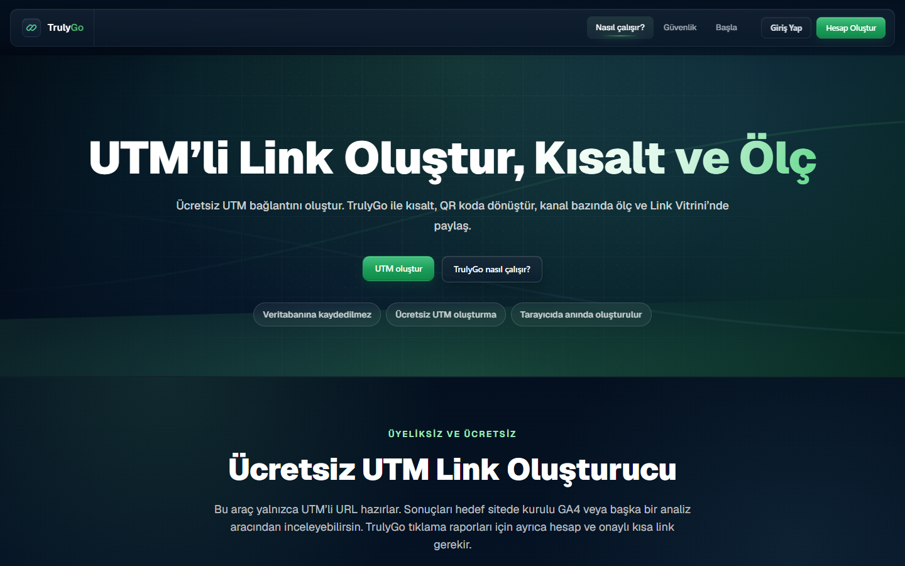
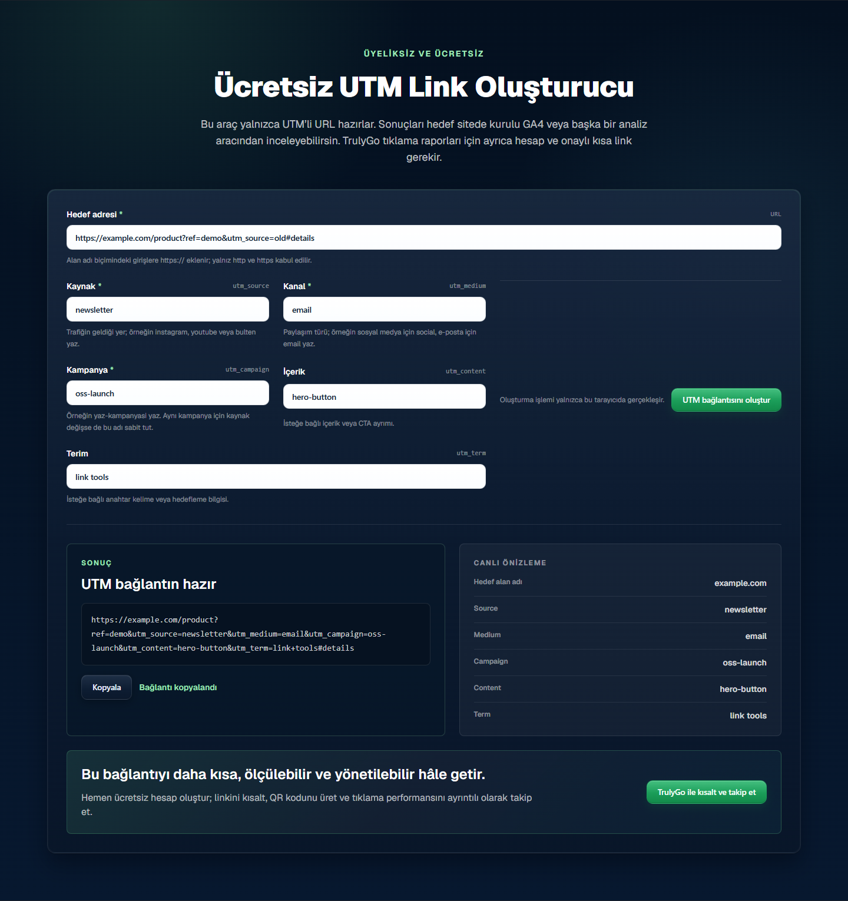
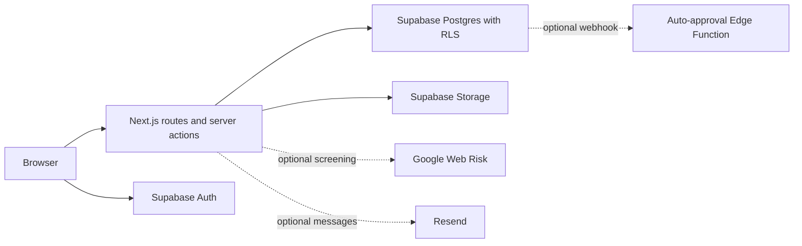

# TrulyGo OSS

A self-hostable link management application built with Next.js, React,
TypeScript, and Supabase. The interface is primarily Turkish; contributor
documentation is in English.

TrulyGo OSS is an independent source distribution. It contains no hosted
service account, production data, credentials, or production deployment settings.
Use your own isolated backend and review settings before hosting an instance.

## Features

- Authenticated short-link requests, an administrator review queue, and public
  redirects for approved links. Approved destinations are immutable.
- Channel links, QR codes, a public UTM builder, click analytics, and exports.
- Public link profiles (Link Vitrini), uploads, and profile-view analytics.
- Surveys (Signal) with results and duplicate-vote controls.
- Optional Google Web Risk screening and an auto-approval Edge Function.
- Optional collaboration requests and transactional email through Resend.

Missing Web Risk configuration leaves requests for manual review. Optional
email, automated approval, and hosted integrations require separate setup.
Approval does not guarantee that a destination remains safe after review.

## Screenshots

Actual captures from the isolated local production build. The UTM example is
synthetic; these images are not evidence of users, adoption, or campaign results.





## Development

Requirements: Node.js 24, npm, and, for data-backed features, Docker and the
Supabase CLI. Use the committed lockfile.

```sh
git clone https://github.com/ozenbilal8-web/trulygo-oss.git
cd trulygo-oss
npm ci --ignore-scripts
npm run dev
```

Open <http://localhost:3000>. With no environment file, public pages can render,
but authentication and database-backed features are unavailable. For a working
instance, follow [the isolated local setup](docs/SELF_HOSTING.md). It applies
the included migrations to a dedicated local Supabase instance, uses synthetic
accounts, and starts with manual link review.

Do not point development at another deployment's accounts or database. Even a
short-link visit can write analytics. Real `.env` files are ignored; copy only
the placeholders in [`.env.example`](.env.example).

## Checks

```sh
npm run lint
npm test
npm run build
npm run typecheck
npm run audit
npm run licenses
npx playwright install chromium
npm run test:e2e
```

The Node suite includes unit and source-contract tests. Those checks are
distinct from a running database, browser flow, or email delivery test. See
[DEVELOPMENT.md](docs/DEVELOPMENT.md) for the verification checklist and
[SECURITY.md](SECURITY.md) for security boundaries. CI runs without production
credentials and does not deploy the application.

## Architecture



Authenticated actions enforce ownership and admin permissions. Trusted link
creation runs on the server with a service credential; browser roles cannot
insert directly into the fully migrated link-request table. Public redirects
use a restricted database RPC. Pending, rejected, and suspended requests are
not public redirects.

| Path | Purpose |
| --- | --- |
| `src/app/` | Routes, server actions, public pages, dashboards, and admin |
| `src/lib/` | Domain logic, adapters, analytics, and authorization |
| `src/components/` | Shared interface components |
| `supabase/` | Local configuration, migrations, and optional Edge Function |
| `tests/` | Unit and source-contract tests |
| `docs/email-templates/` | Auth email sources using the configured Site URL |

## Contribute and operate

- [Contributing](CONTRIBUTING.md) and [Code of Conduct](CODE_OF_CONDUCT.md)
- [Development and verification](docs/DEVELOPMENT.md)
- [Self-hosting and configuration](docs/SELF_HOSTING.md)
- [Security reporting](SECURITY.md)
- [Roadmap](docs/ROADMAP.md)
- [Third-party notices](THIRD_PARTY_NOTICES.md)

The legal pages are configuration templates for independent operators, not a
legal review of a deployment. Set your operator identity and contact details,
review actual data collection and retention, and configure your own policies.
Maintainer support is best effort; no support SLA is provided.

## License

Original project code and documentation are available under [MIT](LICENSE).
Dependencies keep their own licenses. Brand names and trademarks remain with
their owners; the MIT license grants no trademark rights or endorsement.
Undocumented third-party logo files are excluded from this edition and replaced
with neutral interface elements. See [THIRD_PARTY_NOTICES.md](THIRD_PARTY_NOTICES.md).

The npm `private` flag prevents accidental package publication; it does not
restrict the rights granted by the source license.
